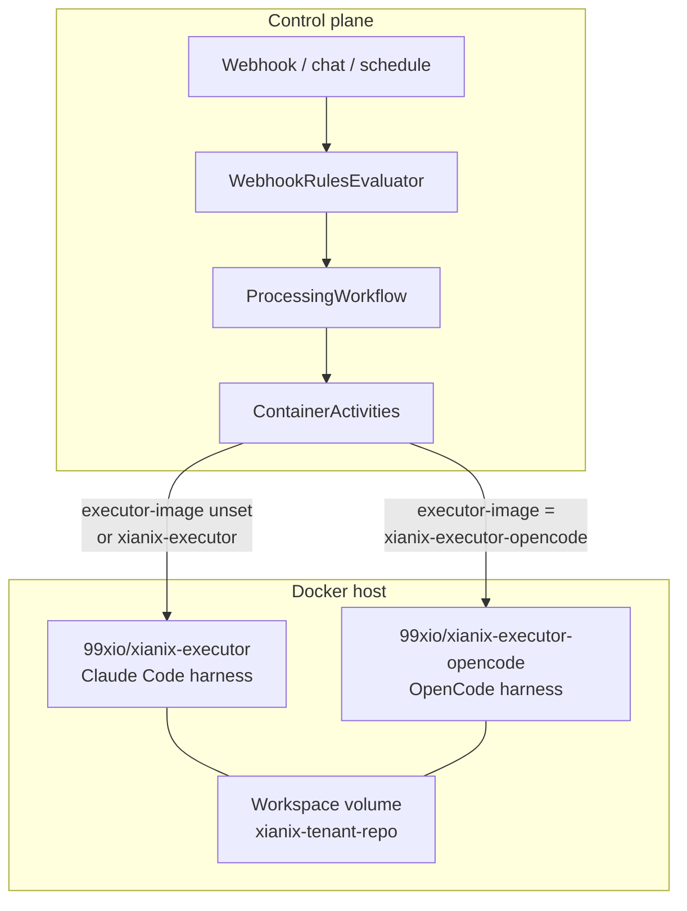

Xianix can run the same `rules.json` plugins on two executor harnesses:

| Harness | Image | Prompt runtime |
|---------|-------|----------------|
| **Claude Code** (default) | `99xio/xianix-executor` | Claude Agent SDK |
| **OpenCode** | `99xio/xianix-executor-opencode` | `opencode run` |

Both share prepare / worktree / tenant-volume isolation. Plugins still come from Claude Code marketplaces (`use-plugins`). The OpenCode image installs those plugins, converts them, then runs the prompt with OpenCode.

Configure the harness per execution with [`executor-image`](/agent-configuration/rules/#executor-image--harness-selection). See also [The Executor](/agent-development/executor/).

---

## Architecture



### Shared layer

Regardless of harness, the control plane:

1. Matches `rules.json` and resolves inputs / `with-envs` / `model` / `executor-image`.
2. Ensures a deterministic Docker volume for `tenant + repo`.
3. Starts a short-lived container with `XIANIX_INPUTS`, `CLAUDE_CODE_PLUGINS`, prompt, and API keys.
4. Collects the JSON envelope from stdout.

### Divergent layer (run phase only)

```text
                    prepare_repo / worktree / credentials
                                    │
                    claude plugin marketplace add + install
                                    │
                 ┌──────────────────┴──────────────────┐
                 ▼                                     ▼
        Claude Code harness                    OpenCode harness
        execute_plugin.py                      convert .md → .opencode/
        Claude Agent SDK                       execute_opencode.py
                                               opencode run --model provider/model
```

| Concern | Claude Code | OpenCode |
|---------|-------------|----------|
| Plugin install | Claude CLI | Claude CLI (same contract) |
| Plugin runtime for the prompt | Native Claude Code | Converted `.opencode/` overlay |
| Model field | Anthropic id (`claude-sonnet-4-5`) | `provider/model` (`openai/gpt-6.1-sol`) |
| Primary API key | `ANTHROPIC_API_KEY` | Key matching provider (`OPENAI_API_KEY`, `ANTHROPIC_API_KEY`, `GOOGLE_GENERATIVE_AI_API_KEY`, …) |

Source trees in [the-agent](https://github.com/xianix-team/the-agent):

- `Executor/` — Claude Code harness  
- `Executor.OpenCode/` — OpenCode harness  
- `plugin-compat/` — optional offline convert tooling used by the OpenCode image path  

---

## Docker images

### Image matrix

| Image | Dockerfile | Role |
|-------|------------|------|
| `99xio/xianix-agent` | `TheAgent/Dockerfile` | .NET control plane |
| `99xio/xianix-executor` | `Executor/Dockerfile` | Default Claude Code harness |
| `99xio/xianix-executor-opencode` | `Executor.OpenCode/Dockerfile` | OpenCode harness |

### What is inside each harness image

**Claude Code (`Executor/`)**

| Piece | Purpose |
|-------|---------|
| `entrypoint.sh` | Mode routing, prepare, execute |
| `prepare_repo.sh` | Bare clone + worktree |
| `execute_plugin.py` | Claude Agent SDK → JSON envelope |
| Claude Code CLI + SDK | Prompt + plugins |

**OpenCode (`Executor.OpenCode/`)**

| Piece | Purpose |
|-------|---------|
| `entrypoint.sh` | Mode routing |
| `prepare_repo.sh` | Bare clone + worktree (same isolation model) |
| `run_prompt.sh` | Plugin install + convert + runtimes + OpenCode |
| `plugin_runtime.py` | Claude plugin `.md` → `.opencode/{commands,agents,skills}` |
| `execute_opencode.py` | `opencode run` → JSON envelope |
| Claude Code CLI | Marketplace install only |
| OpenCode CLI | Prompt execution |
| mise | Runtimes from **repo** version files |

OpenCode does **not** include Playwright/browsers. Claude Code is present only for plugin marketplace install — the agent prompt always runs through OpenCode.

### Build and pull

```bash
# Claude Code harness
cd Executor/
docker build -t 99xio/xianix-executor:latest .

# OpenCode harness
cd Executor.OpenCode/
docker build -t 99xio/xianix-executor-opencode:latest .

# Or pull published tags
docker pull 99xio/xianix-executor:latest
docker pull 99xio/xianix-executor-opencode:latest
```

Host default vs per-execution override:

```env
# TheAgent/.env — default for executions that omit executor-image
EXECUTOR-IMAGE=99xio/xianix-executor:latest
```

```json
"executor-image": "99xio/xianix-executor-opencode:latest"
```

The image must already exist on the Docker host. Different executions in one rule set can use different harnesses without restarting the agent.

### Tests (OpenCode)

```bash
cd Executor.OpenCode/
python -m unittest discover -s tests -v
bash tests/integration_test.sh
```

---

## Workflow

### End-to-end path

```mermaid
sequenceDiagram
  autonumber
  participant Src as GitHub / ADO / Chat
  participant Agent as XianixAgent
  participant Rules as rules.json
  participant PW as ProcessingWorkflow
  participant Box as Executor container

  Src->>Agent: Event
  Agent->>Rules: Match execution block
  Rules-->>Agent: inputs, plugins, model, executor-image
  Agent->>PW: Start workflow
  PW->>Box: docker start (chosen image)
  Box->>Box: prepare_repo + worktree
  Box->>Box: claude plugin install use-plugins
  alt Claude Code image
    Box->>Box: execute_plugin.py Claude Agent SDK
  else OpenCode image
    Box->>Box: convert plugins to .opencode/
    Box->>Box: opencode run --model provider/model
  end
  Box-->>PW: stdout JSON envelope
  PW->>Box: cleanup container
```

### OpenCode run phase in detail

```text
claude plugin marketplace add / plugin install
        ↓ stage installPath
XIANIX_PLUGINS_DIR/<id>/{commands,agents,skills}
        ↓ convert .md only
WORK_DIR/.opencode/{commands,agents,skills}
        ↓
opencode run --model <provider/model> <prompt>
```

1. Install marketplace plugins (`use-plugins`) — same as Claude harness.  
2. Stage each `installPath` under `XIANIX_PLUGINS_DIR`.  
3. Convert Claude `commands/` / `agents/` / `skills/` markdown into OpenCode overlays.  
4. Provision runtimes via mise from the repo’s version files.  
5. Run `opencode run` with `XIANIX-MODEL` (`provider/model`).  
6. Emit the same family of JSON result fields the control plane already expects.

### Example rule (OpenCode PR review)

```json
{
  "name": "github-pull-request-review-opencode",
  "platform": "github",
  "repository": { "url": "repository.clone_url" },
  "match-any": [
    {
      "name": "pr-opencode-label",
      "rule": "action==labeled&&label.name=='ai-dlc/pr/pr-review-opencode'&&pull_request.state=='open'"
    }
  ],
  "use-inputs": [
    { "name": "pr-number", "value": "pull_request.number", "mandatory": true }
  ],
  "use-plugins": [
    {
      "plugin-name": "pr-reviewer@xianix-plugins-official",
      "marketplace": "xianix-team/plugins-official"
    }
  ],
  "with-envs": [
    { "name": "GITHUB-TOKEN", "value": "secrets.GITHUB-TOKEN", "mandatory": true },
    { "name": "OPENAI-API-KEY", "value": "secrets.OPENAI-API-KEY", "mandatory": true }
  ],
  "executor-image": "99xio/xianix-executor-opencode:latest",
  "model": "openai/gpt-6.1-sol",
  "max-budget-usd": 3,
  "execute-prompt": "You are reviewing pull request #{{pr-number}} in {{repository-name}}. Run /pr-review {{pr-number}}."
}
```

### Models and credentials

| Harness | `model` example | `with-envs` key |
|---------|-----------------|-----------------|
| Claude Code | `claude-sonnet-4-5` | `ANTHROPIC-API-KEY` |
| OpenCode | `openai/gpt-6.1-sol` | `OPENAI-API-KEY` |
| OpenCode | `anthropic/claude-sonnet-5-5` | `ANTHROPIC-API-KEY` |
| OpenCode | `google/gemini-3.1-pro-preview` | `GOOGLE_GENERATIVE_AI_API_KEY` |

Confirm OpenCode ids with `opencode models` inside the image before pinning them in rules.

---

## Related docs

- [Rules Configuration — executor-image](/agent-configuration/rules/#executor-image--harness-selection)
- [The Executor](/agent-development/executor/)
- [Webhook Rule Sets](/agent-configuration/rules/webhooks/)
- [Deployment](/agent-development/deployment/)
